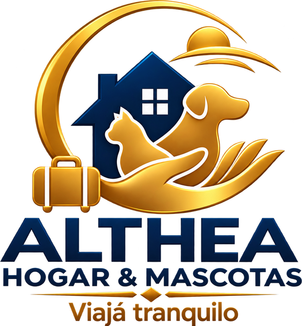
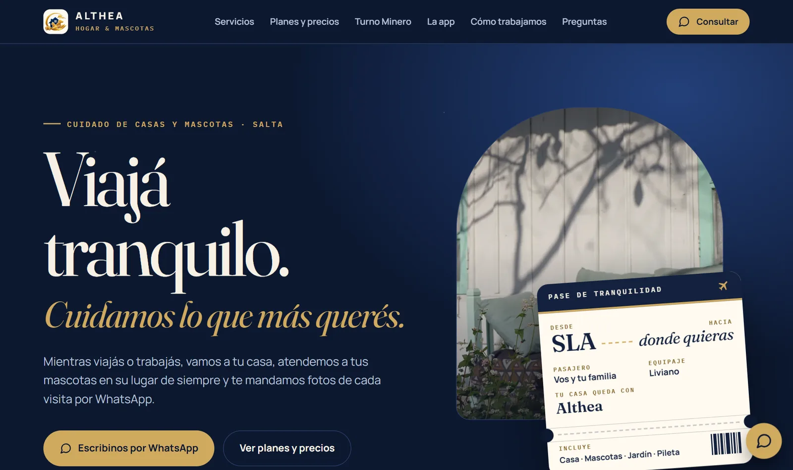
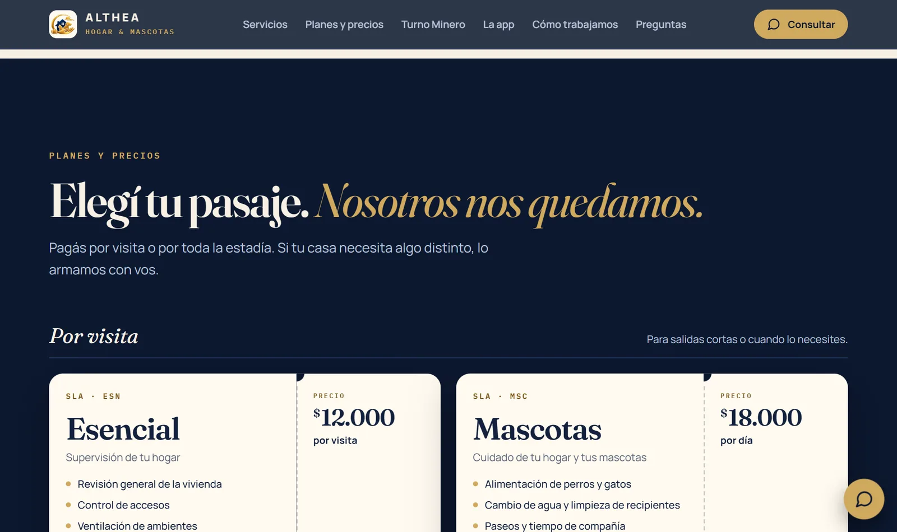

  <picture>
    <source media="(prefers-color-scheme: dark)" srcset="docs/logo-althea-blanco.png">
    
  </picture>

<h1 align="center">Althea · Página para clientes</h1>

  Cuidado de casas y mascotas en Salta y alrededores.
   
  <a href="https://althea-hogar.netlify.app"><strong>Ver la página »</strong></a>
  ·
  <a href="https://althea-salta.netlify.app/?demo"><strong>Probar la app »</strong></a>

## Qué tiene

- **Inicio** con el "pase de tranquilidad": el cliente viaja, la casa queda con Althea.
- **Zonas** en un tablero de salidas: Salta capital, Vaqueros, San Lorenzo, Cerrillos y San Luis.
- **Planes y precios** como pasajes, con botón para reservar por WhatsApp y opción de sumar pileta o jardín.
- **Plan Turno Minero** con calendario según la rotación (7×7, 14×14, 4×3).
- **La aplicación**: cada visita llega al cliente con fotos, en un enlace privado.
- Cómo trabajamos, confianza y preguntas frecuentes.

## Cómo se edita

- Todo está en `index.html`. Los **planes, precios y el WhatsApp** se cambian al final, en el bloque `EDITÁ ACÁ`.
- `img/` tiene las fotos livianas que usa la página; `img-originales/` (no se sube) las de tamaño completo.
- Se publica en Netlify (proyecto `althea-hogar`).

---

  Plataforma realizada por  
  <picture>
    <source media="(prefers-color-scheme: dark)" srcset="docs/lambda-lab-norte-blanco.webp">
    
  </picture>

